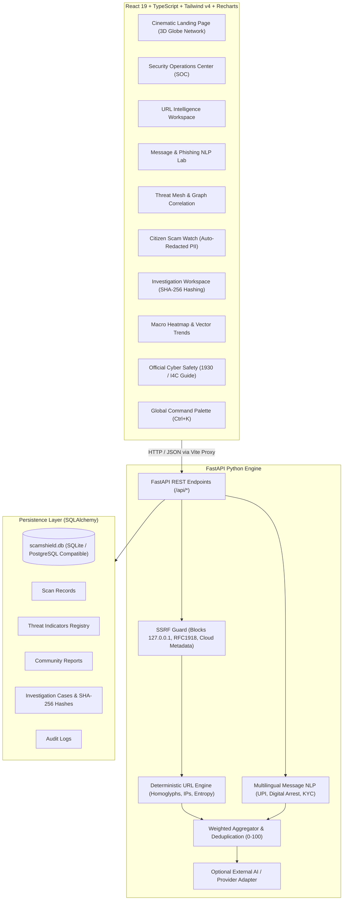

# 🛡️ ScamShield India
### Advanced AI Cybersecurity & Digital Fraud Intelligence Platform

[](https://www.python.org/)
[](https://fastapi.tiangolo.com/)
[](https://react.dev/)
[](https://www.typescriptlang.org/)
[](https://tailwindcss.com/)
[](#detection-engine)
[](https://opensource.org/licenses/MIT)

> **"THINK BEFORE YOU CLICK."**
> A production-grade cybersecurity operations platform engineered specifically to detect, analyze, and explain digital fraud vectors threatening Indian citizens and institutions.

---

## 📋 Executive Overview

**ScamShield India** is not a simple CRUD template or mock demo. It is a fully functional, explainable cyber defense command center designed around the real Indian fraud landscape:
- **UPI Fraud & QR Reversals**: Pinpoint inverted payment logic (*"Scan QR / enter UPI PIN to receive money"*).
- **Digital Arrest Extortion**: Identifies counterfeit Skype interrogations and forged CBI / Police warrants.
- **Banking Lookalikes & Smishing**: Detects typosquatting, homoglyph character substitutions, and deceptive subdomains targeting SBI, HDFC, ICICI, PNB, and UIDAI.
- **Electricity & Utility Threats**: Recognizes 9:30 PM disconnection alerts impersonating state discoms.
- **Multilingual Token Processing**: Support for English and Hindi (Devanagari) fraud keywords with Kannada architectural readiness.
- **Cryptographic Forensics**: SHA-256 evidence hashing for incident dossiers and automated Citizen PII redaction.

---

## 🏛️ System Architecture



---

## 🛡️ Threat Model & Security Controls

| Security Boundary | Protection Implemented |
|---|---|
| **Server-Side Request Forgery (SSRF)** | Outbound HTTP requests to submitted URLs are disabled by design. The SSRF guard strictly validates against IPv4/IPv6 loopback, RFC1918 subnets, and AWS/GCP cloud metadata (`169.254.169.254`). |
| **Citizen Privacy (PII Protection)** | Automated regex masking redacts 10-digit Indian phone numbers, 16-digit payment cards, 12-digit Aadhaar numbers, and OTP sequences prior to database persistence. |
| **Evidence Tamper-Evidence** | SHA-256 cryptographic digests are computed client-side and verified server-side for all attached evidence files in case dossiers. |
| **No Infallibility Claim** | Risk scores represent deterministic heuristic aggregations (0-100) and explicitly disclose limitations and false-positive boundaries. |

---

## 🚀 Workspaces & Features

### 1. 🌐 Cinematic Landing Page (`/`)
- Visual centerpiece: Interactive 3D particle cyber globe with real-time radar sweeps and pulsing Indian threat nodes.
- Animated live counters featuring indexed threat signatures, analyzed fraud indicators, and estimated prevented losses (clearly labeled demonstration baseline).
- Live Telemetry Ticker streaming active alerts regarding Digital Arrest spikes and fake electricity discom warnings.

### 2. 📊 Security Operations Dashboard (`/dashboard`)
- Recharts-powered **Threat Activity Timeline** (scans initiated vs fraud signatures blocked).
- **Risk Distribution Donut Chart** (Low, Medium, High, Critical).
- **Top Detected Threat Vectors in India** bar chart.
- Real-time recent scan ingestion feed from SQLite database.

### 3. 🔎 URL Intelligence Engine (`/url-scanner`)
- Step-by-step verified execution progress stepper (*Input Validation → Normalization → Structure Breakdown → Lookalike Detection → SSRF Safety → Risk Scoring → Report Synthesis*).
- Brand impersonation detection covering SBI, HDFC, ICICI, PNB, UIDAI, IncomeTax, and Indian telcos.
- Direct IP host detection (`http://192.168.1.1/sbi`), homoglyph substitution (Cyrillic lookalikes), Shannon domain entropy calculation, and URL shortener detection.

### 4. 💬 Message & Phishing Intelligence Lab (`/message-scanner`)
- Multi-channel support: SMS, WhatsApp, Email, Telegram.
- **Interactive In-Text Highlight**: Suspicious phrases are highlighted with character-span precision; clicking an underline focuses the forensic evidence card.
- Indian fraud categories: UPI PIN fraud, Digital Arrest Skype extortion, Fake KYC suspension, Electricity cutoff, India Post fake parcel delivery, and KBC lotteries.
- Multilingual support: English, Hindi (Devanagari), and Kannada-ready architecture.

### 5. 🕸️ Threat Explorer & Correlation Mesh (`/threat-explorer`)
- Search by domain, UPI handle, or category.
- Filter by risk level (Critical, High, Medium, Low) and verified status.
- **Graph Mesh View**: SVG relationship graph connecting the National Threat Mesh hub to threat categories and individual indicators.
- Export threat intelligence feed as structured JSON.

### 6. 📂 Investigation Workspace (`/investigations`)
- Case docket manager with case numbers, priority badges, tags, and analyst logs.
- Cryptographic SHA-256 integrity hashing on uploaded files with metadata logging.
- Audit timeline of all actions taken by investigators.
- One-click downloadable case dossier report.

### 7. 📢 Community Scam Watch (`/community-reports`)
- Crowdsourced reporting portal with real-time PII auto-redaction.
- Duplicate detection algorithm based on indicator similarity.
- Community upvote and moderation flag system.

### 8. 🚨 Official Indian Cyber Safety Center (`/cyber-safety`)
- **Emergency Helpline 1930 Guide**: Step-by-step instructions for the Citizen Financial Cyber Fraud Reporting System and the critical **Golden Hour** (2-3 hour recovery window).
- **Digital Arrest Reality Check**: Legal facts proving no Indian agency conducts arrests or warrants via video call.
- Official direct links to `cybercrime.gov.in`, Sanchar Saathi (Chakshu), and RBI consumer portals.

### 9. ⚙️ Platform Settings (`/settings`)
- Ruleset version verification (`v1.2.0-in`).
- Heuristic scoring sensitivity tuning (Balanced, Aggressive, Conservative).
- SSRF & Privacy guard status toggles.
- Optional external provider configuration (VirusTotal, Gemini AI).

---

## 🛠️ Quickstart Installation (Windows)

### Prerequisites
- **Python 3.12+**
- **Node.js 20+** & **npm**

### Option A: One-Click Dev Launcher
Simply double-click `run_dev.bat` in the root folder, or run in PowerShell:
```powershell
.\run_dev.bat
```

### Option B: Manual Launch

#### 1. Backend Setup:
```powershell
cd backend
python -m pip install -r requirements.txt
python -m uvicorn app.main:app --host 127.0.0.1 --port 8000 --reload
```
*API documentation and Swagger UI will be available at [http://127.0.0.1:8000/docs](http://127.0.0.1:8000/docs).*

#### 2. Frontend Setup:
```powershell
cd frontend
npm.cmd install
npm.cmd run dev
```
*Application workspace will be available at [http://localhost:5173](http://localhost:5173).*

---

## 🧪 Automated Testing

Run the comprehensive pytest suite covering URL heuristics, homoglyphs, Hindi message tokens, scoring de-duplication, and API integration:

```powershell
cd backend
python -m pytest -v
```

Expected output:
```
tests/test_api.py::test_root_endpoint PASSED
tests/test_api.py::test_health_endpoint PASSED
tests/test_api.py::test_url_analyze_api PASSED
tests/test_api.py::test_message_analyze_api PASSED
tests/test_api.py::test_dashboard_analytics_api PASSED
tests/test_message_detector.py::test_upi_pin_fraud_detection PASSED
tests/test_message_detector.py::test_digital_arrest_scam_detection PASSED
tests/test_message_detector.py::test_fake_kyc_hindi_detection PASSED
tests/test_message_detector.py::test_legitimate_otp_message PASSED
tests/test_message_detector.py::test_telegram_task_job_scam PASSED
tests/test_scoring.py::test_aggregate_empty_indicators PASSED
tests/test_scoring.py::test_aggregate_deduplication PASSED
tests/test_scoring.py::test_aggregate_score_ceiling PASSED
tests/test_url_detector.py::test_legitimate_bank_url PASSED
tests/test_url_detector.py::test_lookalike_sbi_domain PASSED
tests/test_url_detector.py::test_bare_ip_address_host PASSED
tests/test_url_detector.py::test_homoglyph_detection PASSED
tests/test_url_detector.py::test_shannon_entropy PASSED

18 passed in 1.11s
```

---

## 📞 Official Emergency Channels

If you or someone you know has suffered financial cyber fraud in India:
1. **Immediately dial 1930** (National Cyber Crime Helpline).
2. Report the incident online at [cybercrime.gov.in](https://cybercrime.gov.in).
3. Notify your bank to initiate a transaction dispute and beneficiary account freeze.

---

## 📄 License
This project is licensed under the [MIT License](LICENSE).
